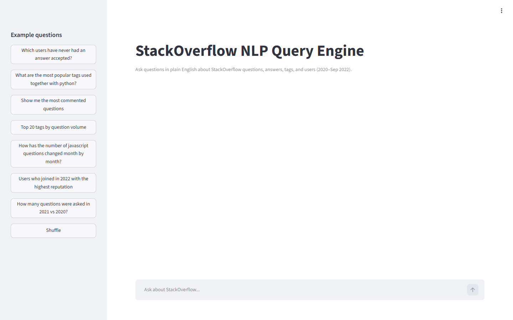

# StackOverflow NLP Query Engine



Ask plain-English questions about a 1-in-16 sample of real Stack Overflow data (questions with 38 popular
tags, Jan 2020 – Sep 2022) and get back the SQL the model wrote plus a results table. Built for people
interested in SQL: every answer shows the query behind it.

**Live demo: https://stackoverflow-nlp-query-engine.onrender.com/**
(free Render tier: the first visit after idle takes about a minute to wake up; each session is capped at
12 questions and the site at 100 questions a day)

**Result:** on a second test set of 113 answerable questions, written and frozen before the model ran, the
generated SQL returned the reference answer for 92, 89 and 88 questions in 3 runs (79.4%), and every question
about data that does not exist was declined. A first, smaller set (38 questions) got 37 right in each run.
Method and details: [`eval/RESULTS.md`](eval/RESULTS.md).

## Example

*Which 10 tags have the most comments on their questions?*

```sql
SELECT t.tag_name, SUM(c.cnt) AS comment_count
FROM (SELECT post_id, COUNT(*) AS cnt FROM comments GROUP BY post_id) c
JOIN post_tags pt ON pt.post_id = c.post_id
JOIN tags t ON t.tag_id = pt.tag_id
JOIN posts_questions q ON q.post_id = c.post_id
GROUP BY t.tag_id, t.tag_name
ORDER BY comment_count DESC
LIMIT 10;
```

| tag_name | comment_count |
|---|---|
| python | 89,853 |
| javascript | 66,674 |
| java | 37,625 |

(first 3 of 10 rows; counts describe the sample)

## Why

Answering "which tags are trending?" or "who has the highest answer acceptance rate?" against a relational
database normally takes SQL and knowledge of the schema. This project translates the question itself,
grounded in the real schema, and checks the SQL before it reaches the database.

## How it works

- **Database**: 7-table normalized SQLite schema (users, tags, questions, answers, tag join table,
  comments, votes) loaded from a sampled BigQuery export. See [Data](#data) and
  [`docs/DATA_SCHEMA.md`](docs/DATA_SCHEMA.md).
- **Query suite**: 15 hand-written analytical SQL queries covering the join and aggregation patterns the
  NLP layer needs to reproduce. All 15 run against the data. See [`docs/METHODOLOGY.md`](docs/METHODOLOGY.md).
- **NLP layer**: Claude (`claude-sonnet-5-5`), prompted with the schema, notes on non-obvious columns and
  the data's date range, and 4 few-shot examples drawn from the query suite. When the data to answer a
  question does not exist (salaries, who cast a vote), the model says so instead of guessing.
- **Safety**: generated SQL must be a single `SELECT`/`WITH` statement with no write or schema keywords
  (text inside quotes and comments is ignored). The app opens the database read-only, stops queries after
  30 seconds and returns at most 1,000 rows.
- **Interface**: Streamlit chat app. Type a question or click one of 7 random example questions (35 in the
  pool, Shuffle for more), then see the generated SQL and the result table.

Request flow and design tradeoffs: [`docs/ARCHITECTURE.md`](docs/ARCHITECTURE.md).

## Evaluation

There are two evaluation sets, each with reference SQL, and a question passes when the generated SQL returns the
same rows as the reference, whatever the SQL looks like. Each question was run 3 times.

- **First set:** 60 questions. Twenty were used to tune the prompt and 40 (38 answerable, 2 about data that
  does not exist) were frozen before the first scored run. Their reference results were recomputed independently
  in pandas.
- **Second set:** 126 questions (113 answerable, 13 about data that does not exist), frozen in git before the model
  saw them. 90 were written by the AI assistant used on this project and 36 by the author; each reference was
  derived independently by two writers, and the author decided where they differed.

| | Questions | Result |
|---|---|---|
| Second set, answerable | 113 | 92, 89 and 88 correct in the 3 runs (79.4%) |
| Second set, unanswerable | 13 | declined in every run |
| First set, answerable | 38 | 37 of 38 correct in every run |
| First set, unanswerable | 2 | declined in every run |

On 113 questions a 95% interval around 79.4% is 71.0% to 85.8%. A schema-only baseline prompt answered 86 of 113,
which the answerable questions cannot tell from the full prompt; it declined only 3 of the 13 unanswerable
questions. 27 questions were not right in every run, and most of those measure how a question was worded or read
more than a wrong answer. [`eval/RESULTS.md`](eval/RESULTS.md) lists the scoring rules, the causes and the limits.

## Data

Source: `bigquery-public-data.stackoverflow` (a mirror of the Stack Exchange data dump), exported on
2026-09-21 through a free Kaggle Notebook with [`data/kaggle_export.py`](data/kaggle_export.py). The slice is:

- questions with at least one of 38 popular tags (python, javascript, java, sql, …), with a **1-in-16
  sample** by post id. The tag filter alone matches ~2.8M questions, too large for a local SQLite file, and
  the sample keeps queries fast
- **2020-01-01 to 2022-09-25**, where the public BigQuery mirror stops
- answers, comments, votes and authors for the sampled questions; post bodies truncated to 500 characters

Result: 174,131 questions, 186,018 answers, 572,119 comments, 487,387 votes, 227,026 users, 63,653 tags (all
tags are loaded, not just the 38). Voters are anonymized in the source, so votes can be counted by post and
type but not by user. Email-like and phone-like strings in titles, post bodies and comments are replaced with
`[email removed]` and `[phone removed]` when the database is built. Details:
[`docs/DATA_SCHEMA.md`](docs/DATA_SCHEMA.md).

The raw CSVs and the database are not committed to git. The built database is published as a gzipped GitHub
Release asset
([`data-v2`](https://github.com/brianravelo28/stackoverflow-nlp-query-engine/releases/tag/data-v2), ~175 MB)
so you can skip the Kaggle step. `src/download_db.py` checks its SHA-256 before unpacking.

## How to Run

```bash
pip install -r requirements-dev.txt   # requirements.txt is the slimmer deploy set

# Option A: skip the export and download the prebuilt database
python src/download_db.py

# Option B: rebuild from scratch
#   1. run data/kaggle_export.py in a Kaggle Notebook (Stack Overflow BigQuery
#      dataset attached), download the 6 CSVs into data/
python src/build_db.py
python src/add_indexes.py

# Checks
python -m pytest                      # unit tests, no API key or database needed
python src/queries.py                 # the 15-query suite

# Run the app
export ANTHROPIC_API_KEY=your_key_here
streamlit run app/app.py

# Re-run the evaluation (needs the database and an API key)
python eval/run_eval.py --split test --runs 3 --label my-run
python eval/score.py eval/runs/my-run.json
```

## Deploy (Render)

[`render.yaml`](render.yaml) defines a free web service. The build runs `src/download_db.py`, which fetches
the release asset (the 480 MB database is too large for git and is downloaded on every deploy). The app
opens the database read-only, caps each session at 12 questions and the site at 100 a day, and limits each
query to 30 seconds and 1,000 rows.

1. Render → New → Blueprint → connect this repo
2. Set `ANTHROPIC_API_KEY` when prompted, and set a monthly spend limit on the key in the Anthropic Console

## Files

```
README.md
LICENSE                          MIT (code only; see docs/CITATIONS.md for the data license)
render.yaml                      Render service definition
requirements.txt                 pinned deploy dependencies
requirements-dev.txt             adds pyarrow, matplotlib, jupyter, pytest
data/
  kaggle_export.py               BigQuery export, run in a Kaggle Notebook
src/
  download_db.py                 fetch the prebuilt database from the GitHub Release
  build_db.py                    schema + CSV loader + foreign-key check
  add_indexes.py                 10 indexes
  queries.py                     15 analytical queries
  nlp_layer.py                   Claude-backed text-to-SQL, SQL gate, timeout and row cap
app/
  app.py                         Streamlit chat interface
eval/
  questions.json                 the 60 evaluation questions with reference SQL
  reference_results.json         saved reference answers (scoring needs no database)
  build_eval_set.py              builds questions.json and REVIEW.md (the review sheet)
  crosscheck.py                  recomputes every reference in pandas
  run_eval.py                    asks the model every question and saves the output
  score.py                       execution-match scorer
  RESULTS.md                     results, method and limits
  runs/                          raw and scored runs
tests/                           unit tests for the gate, limits, scorer, loader and downloader
notebooks/
  01_eda.ipynb                   exploratory analysis (needs the database built)
docs/
  ARCHITECTURE.md                design, request flow, safety model
  DATA_SCHEMA.md                 ER diagram, table definitions, scoping
  METHODOLOGY.md                 prompt design, query suite, evaluation
  CITATIONS.md                   sources and data license
```
