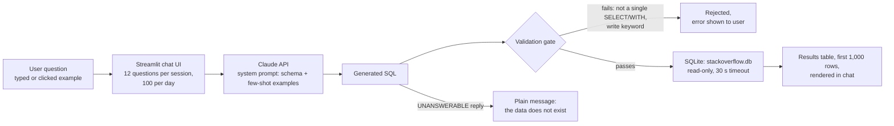

# System Architecture

## What this is

A natural-language query interface over a normalized StackOverflow sample database: type a plain-English
question, get back the generated SQL and a results table. The interesting engineering is in the middle
layer, which combines schema-grounded prompting, few-shot examples taken from a hand-written query suite,
and a safety gate with execution limits. It is more than a call to the API.

---

## Request Flow



**Components**:
1. **Streamlit chat UI** ([`app/app.py`](../app/app.py)): session-state chat history, with the generated SQL and result table rendered per turn. It shows 7 random questions from a pool of 35 as clickable buttons (Shuffle for another 7) and stops accepting questions after 12 per session, and after 100 a day across the whole site, to limit API spend. A caption states that the data is a 1-in-16 sample, and a footer credits Stack Exchange.
2. **NLP layer** ([`src/nlp_layer.py`](../src/nlp_layer.py)): `generate_sql()` calls Claude with a system prompt that lists every table and column (a column list, not full DDL), notes on the non-obvious ones (`parent_id` semantics, what `is_accepted` means) and 4 few-shot examples drawn from the 15-query suite. The prompt also states the data's date range (so "last month" means relative to 2022-09-25, not today) and that year-over-year comparisons should use complete years. It tells the model to reply `SELECT 'UNANSWERABLE: <reason>'` when the data to answer a question does not exist, and the app shows that as a plain message. API failures raise a `GenerationError` with a message that is safe to show.
3. **Validation gate** (`check_sql()` in the same file): accepts a single `SELECT`/`WITH` statement and rejects the rest. It first strips string literals, quoted identifiers and comments, so `LIKE '%update%'` is fine. It then rejects a second statement and any write or schema keyword used as a keyword (`DROP`, `DELETE`, `UPDATE`, `INSERT`, `ALTER`, `ATTACH`, `DETACH`, `PRAGMA`, `CREATE`, `VACUUM`, `REPLACE`). SQLite's `REPLACE()` function is allowed.
4. **Execution** (`validate_and_execute()`): runs the checked query with a 30-second timeout (a SQLite progress handler) and returns at most 1,000 rows, noting when the result was cut.
5. **SQLite database** ([`src/build_db.py`](../src/build_db.py)): 7 normalized tables and 10 indexes (see below) tuned for the query patterns in the suite.

---

## Safety Model

The validation gate is a **tokenizer-based check**, not a full SQL parser. It guards against a model emitting
a destructive or multi-statement query, not against a deliberately adversarial user. Layers around it:
1. The Streamlit app opens the database **read-only** (`mode=ro`), so even a query that got past the gate
   could not modify it. The command-line scripts (`nlp_layer.py`, `queries.py`) open it read/write against a
   local, regenerable file.
2. Each query stops after 30 seconds and returns at most 1,000 rows, which protects the free-tier server's
   CPU and memory on tables of 570,000 rows.
3. This is a portfolio demo, not a multi-tenant service, so the main exposure is API spend. Sessions are
   capped at 12 questions, but the cap resets on page refresh. The site-wide cap of 100 questions a day is
   held in memory and resets when the service restarts. A monthly spend limit on the API key is the final
   backstop.

For a production deployment, the next steps would be a dedicated SQL parser (e.g. `sqlglot`) that inspects
the parsed statement type, plus per-user rate limiting.

---

## Indexing Strategy

10 indexes ([`src/add_indexes.py`](../src/add_indexes.py)), chosen to match the join and filter columns used
across the 15-query suite:

| Index | Supports |
|---|---|
| `posts_questions(creation_date)` | Date-range filters, "recent questions", YoY growth |
| `posts_questions(user_id)` | User → their questions |
| `posts_answers(parent_id)` | Question → its answers (the most common join) |
| `posts_answers(user_id)` | User → their answers, acceptance-rate queries |
| `posts_answers(creation_date)` | Time-to-first-answer queries |
| `post_tags(tag_id)` | Tag → questions (tag volume, tag co-occurrence) |
| `comments(post_id)` | Post → its comments |
| `comments(user_id)` | User → their comments |
| `votes(post_id)` | Post → its votes |
| `users(reputation)` | Reputation ranking and filtering |

---

## Data Movement

```
Kaggle Notebook (BigQuery client, free tier)
    ↓ data/kaggle_export.py: curated tags, 1-in-16 sample
data/*.csv  (git-ignored)
    ↓ src/build_db.py   (creates the schema, appends rows, checks foreign keys)
    ↓ src/add_indexes.py
stackoverflow.db (SQLite, git-ignored, ~480 MB)
    ↓ gzip, uploaded as GitHub Release asset data-v1 (~175 MB)
Render build: src/download_db.py fetches it, verifies its SHA-256 and unpacks it
```

The repo ships the export script and the loader, not the raw CSVs or the database; the database is published
separately as a release asset. Anyone can either rebuild it from BigQuery or run `src/download_db.py`.
